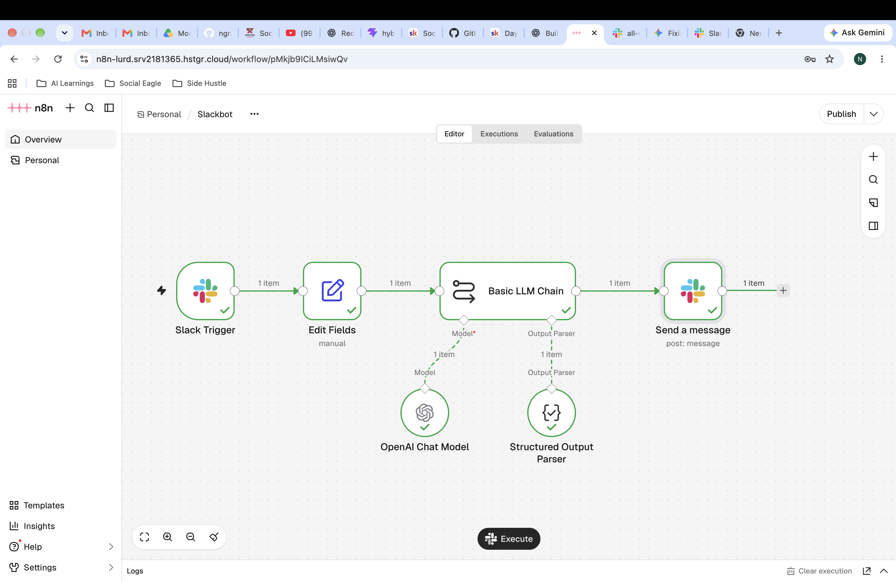
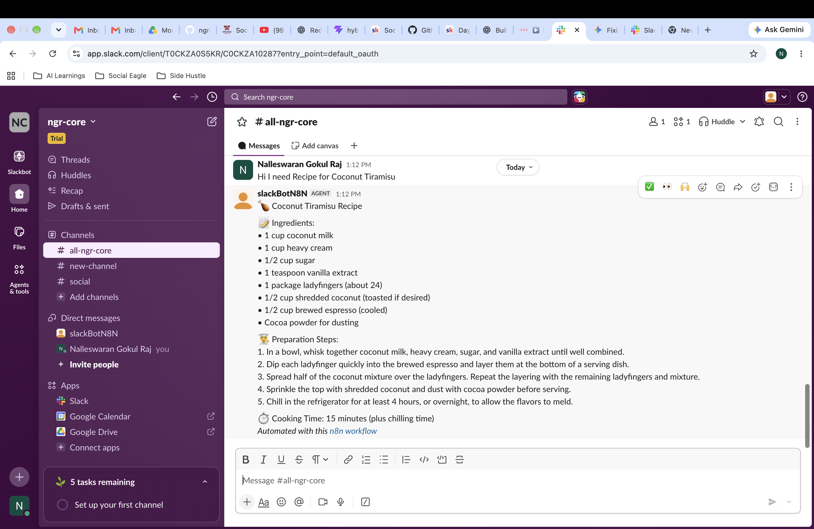

# Slack AI Bot Automation

An n8n workflow that listens to Slack messages in a channel, sends them to
OpenAI for analysis, and replies in the same channel with a structured
response.

The workflow is built to recognize recipes, questions, tasks, summaries, and
general conversations. The included configuration and Slack example focus on
recipe generation.

## Workflow



The workflow runs as follows:

1. **Slack Trigger** receives a new message from the configured Slack channel.
2. **Edit Fields** extracts the message text, Slack user ID, channel ID, and
   message timestamp.
3. **Basic LLM Chain** sends the message to OpenAI and asks it to identify the
   intent and category.
4. **Structured Output Parser** converts the response into a consistent JSON
   structure containing a category, intent, title, response, structured data,
   and action-required flag.
5. **Send a message** posts the generated result back to the Slack channel.

## Example



For example, a user can ask:

```text
Hi! I need a recipe for Coconut Tiramisu.
```

The bot analyzes the request and returns a formatted Slack response with
ingredients, preparation steps, and cooking time.

## Files

- `Slackbot.json` - importable n8n workflow
- `slack-automation-n8n-workflow.png` - screenshot of the workflow in n8n
- `slack-bot-reply.png` - screenshot of the bot response in Slack

## Requirements

- An n8n instance
- A Slack workspace
- A Slack app with permission to receive channel messages and post messages
- An OpenAI API account

The workflow uses `gpt-4o-mini` and may incur OpenAI API usage charges.

## Slack setup

1. Create a Slack app in the Slack workspace.
2. Subscribe the app to message events for the channel that will contain the bot.
3. Add the app to that channel.
4. In n8n, create a Slack API credential and connect it to the Slack Trigger
   and Send a message nodes.
5. Select the target Slack channel in both Slack nodes.

The exact Slack app scopes depend on your workspace configuration, but the app
must be able to read messages from the channel and post messages as a bot.

## OpenAI setup

In n8n, create an OpenAI API credential and assign it to the **OpenAI Chat
Model** node.

Keep the API key private. Do not add it to the workflow JSON or commit it to
source control.

## Import and configure

1. Open n8n and choose **Import from File**.
2. Import `Slackbot.json`.
3. Open the **Slack Trigger** node and connect it to the Slack app credential.
4. Select the Slack channel to monitor.
5. Open **OpenAI Chat Model** and select an OpenAI credential.
6. Open **Send a message** and select the same Slack credential and channel.
7. Activate the workflow.

The exported JSON contains references to the original Slack channel and
credential IDs. Re-select the channel and credentials after importing the
workflow into another n8n instance.

## Structured response

The model is prompted to return data in this format:

```json
{
  "category": "recipe",
  "intent": "generate_recipe",
  "title": "Coconut Tiramisu",
  "response": "A complete generated response",
  "structured_data": {
    "ingredients": [],
    "steps": [],
    "cooking_time": "15 minutes"
  },
  "action_required": false
}
```

The Send a message node currently formats this response as a recipe. Requests
from other categories may require extending the node so that it safely renders
their `response` or category-specific fields.

## Test

1. Activate the workflow.
2. Post a message in the configured Slack channel.
3. Add the Slack app to that channel if it is not already present.
4. Review the n8n execution to confirm that Slack, OpenAI, and the output parser
   all receive the expected data.
5. Confirm that a bot reply appears in Slack.
